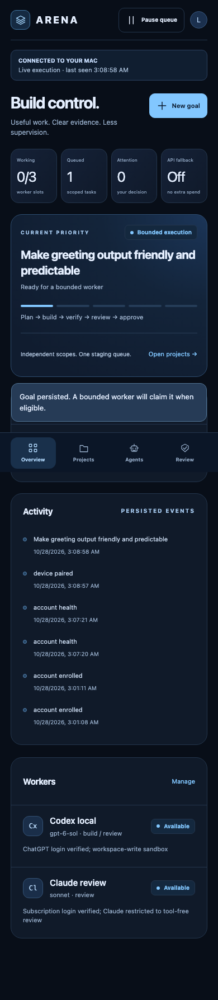

# Autobuild (agent-workflow-orchestrator)

**A phone-operated autonomous software builder that runs on one Mac.** You describe a change in plain language and leave. A director model turns the request into an engineering specification; Codex CLI and Claude Code workers build it in isolated workspaces; sandboxed checks, a review by the other provider and an approval record decide what reaches the project's local `main`. No model ever decides on its own that work is verified.



**Live results** (committed in [`docs/build-evidence/`](docs/build-evidence/), 28 October 2026):

| Run | Request typed on the phone | Request to verified staging | Integration |
|---|---|---|---|
| [First build](docs/build-evidence/first-build/timeline.log) | "Make this app easier to recognise on my phone. Keep everything else working." | 178 s (browser closed while it worked; UI acknowledged in 109 ms) | One tap to accept |
| [Parallel build](docs/build-evidence/parallel-build/timeline.log) | Two changes in one sentence | 669 s, Codex and Claude building concurrently | One tap to accept |
| [Zero-tap build](docs/build-evidence/zero-tap-build/timeline.log) | "Stop malformed server addresses getting through. Keep valid connections working exactly as before." | 210 s | Automatic under the project's policy, no taps |
| [Restart recovery](docs/build-evidence/restart-recovery/result.json) | Controller killed while two provider builds ran | Workers kept running; the restarted scheduler reconciled both | No duplicate or repeated build |

## How a request flows

1. **Request:** the phone sends one sentence, which is persisted as a goal plus a director `plan` task.
2. **Director:** a model works read-only in a clone of the repository and returns a JSON specification. It is validated before anything runs: scope inside the project's enrolled authority, acyclic task dependencies, testable acceptance criteria. If the request is ambiguous, it parks with one question for the owner.
3. **Build:** tasks are claimed atomically using lease tokens, with scope-overlap guards and a per-project writer limit. Codex builds in a workspace-write sandbox. Claude returns whole-file operations that the controller applies after path validation. Frozen checks run in the macOS sandbox. Candidate files are fingerprinted before and after the checks, so nothing unverified can be committed.
4. **Review:** the other provider reviews the diff in a fresh context and must return `{"approved": bool, "findings": [...]}`. The director then judges diff, checks and review against the agreed outcome.
5. **Composition:** the candidate is applied to a staging branch, the checks rerun on the combined result, and an approval record covers every staged task.
6. **Integration:** under the `manual` policy the owner accepts on the phone. Under `auto_local_main` the controller integrates once every gate has passed. A fast-forward of local `main` uses intent and receipt files to survive a crash between git and SQLite. **Nothing is ever pushed.**
7. **Repair:** failed checks or review findings go back to the director, which writes one corrective task. Budgets are 2 repairs, 2 retries and 2 recoveries. A rate-limited account cools down and work may switch provider.

## What makes it safe to leave running

- **Deterministic gates:** a model's review can reject a candidate but can never rescue one that fails a required check.
- **Isolation:** every attempt runs in its own process group, in an isolated workspace at a frozen base commit, with a scrubbed environment. Protected paths and scope are enforced. The source checkout is never written except by fast-forward.
- **Durable state:** a SQLite (WAL) ledger records projects, goals, tasks, attempts, approvals, sessions and events, with optimistic revisions and an idempotent command log. Orphaned workers are verified by pid, create time and boot time before they are signalled.
- **Access:** the listener is loopback-only, exposed only inside the owner's Tailscale network (never Funnel). Each device pairs once with a one-time code. Sessions are HttpOnly/Secure/SameSite=Strict with per-device revocation; mutations need a CSRF token; Host and Origin are allow-listed; a CSP applies; secrets are redacted from transcripts.
- **Evidence on disk:** prompts, argv, transcripts, checks, diffs and receipts are stored with SHA-256 manifests. The UI never shows progress it has not recorded.

**Owner decisions it never takes:** enrolling a repository (done on the Mac, never from the phone), behaviour questions it cannot infer, remote publication, spending, and anything outside the enrolled scope.

## Stack

Python 3.11, FastAPI, SQLite, launchd login service; React 19, TypeScript and Vite for the UI, with live updates over server-sent events and dictation in the browser. Model routing picks provider, model and effort per task from the advertised model catalog, task risk and recorded outcomes. Full detail is in [docs/ARCHITECTURE.md](docs/ARCHITECTURE.md). The threat model is in [docs/THREAT_MODEL.md](docs/THREAT_MODEL.md), and operation is covered in [docs/MOBILE_BUILD_CONTROL.md](docs/MOBILE_BUILD_CONTROL.md).

```bash
pip install -e '.[dev,control]' && pytest -q
```

The suite runs offline with scripted providers and fake runners: no credentials and no model calls. A handful of tests need the real host (macOS sandbox and process-identity checks) and fail inside restricted sandboxes. See `docs/build-evidence/full-regression-*.txt`.

**Status:** alpha. It runs on one MacBook against the owner's own subscriptions. Engineering policies (compute routing, provider reserves) are recorded in [docs/DECISIONS.md](docs/DECISIONS.md); that is a policy record, not proof that every policy has shipped.

## Earlier work in this repository

The project began as a two-agent contest harness, and its core rule carried into Autobuild: plain code, not a model, owns pass/fail.

Do two coding agents catch each other's mistakes? Codex and Claude build the same task in separate worktrees, review each other's diffs, and plain code decides what passes.

**Result:** In the one recorded live Codex-versus-Claude contest, Codex's review caught a Unicode lowercasing bug in Claude's first implementation, and Claude fixed it in revision. That is one observation, not a rate; it motivated the controlled experiment in [agent_reliability_lab](https://github.com/retinapeg/agent_reliability_lab).

**Why it matters:** A model's review can reject a candidate but can never rescue one that fails a required check. Scoring reads only deterministic check results, so the harness, not the models, owns the pass/fail decision.

**Status of the contest harness:** its design fed into [institutional-ai](https://github.com/retinapeg/institutional-ai). Later additions (a single-agent `run` mode, task queues, a local control panel and an Anthropic API adapter) have only smoke runs (recorded in `STATE.md` and `results/`; the control panel was exercised only with fake CLIs) and no controlled results.

- Each agent works in its own Git worktree cut from one frozen commit, and every candidate is re-checked in a fresh detached worktree of its snapshot.
- 197 offline tests with scripted providers and fake runners; no credentials or model calls needed.
- The contest record is prose in [VALIDATION.md](VALIDATION.md); its audit archive is kept outside the repository.

**Run mode (October 2026):** the harness runs Claude Code or Codex headless on a task file, checks each step itself, prices each call from a user-supplied pricing table (unpriced calls are recorded as null) and writes a build journal per queue. See [docs/RUN_MODE.md](docs/RUN_MODE.md) for `run` and the cost ledger, and [docs/GUIDE.md](docs/GUIDE.md) for the control panel; queues and build journals are so far described only in `STATE.md` (2026-10-04 entry).

```bash
pip install -e '.[dev]' && pytest -q      # 197 tests collected; all passed on 2026-10-06
```

[Technical details →](docs/GUIDE.md)

## AcquisitionOps: synthetic campaign orchestration

A separate, human-approved campaign workflow now demonstrates expected-value budget optimization, deterministic eligibility, durable SQLite approval and audit, an idempotent mock provider, restart recovery and delayed conversion outcomes. It uses frozen synthetic prospects and **scripted recommendations, with no live model calls or real delivery**.

```sh
PYTHONPATH=src python3 -m agent_arena.acquisition demo
```

This safe entry point does not invoke the coding-agent CLI, queues or worktrees. It starts a local dashboard with a fresh synthetic database. Dashboard browser verification remains pending because this recovery sandbox denies listener binding. The service/action tests and frozen evaluation run without a listener.

[Demo and limitations](docs/acquisition/README.md) · [Evaluation](docs/acquisition/evaluation/report.md) · [Architecture](docs/acquisition/architecture.md) · [Learning guide](LEARNING_GUIDE.md) · [Two-minute demo](docs/acquisition/interview-demo.md) · [Recovery report](RECOVERY_JOB_C_REPORT.md)
