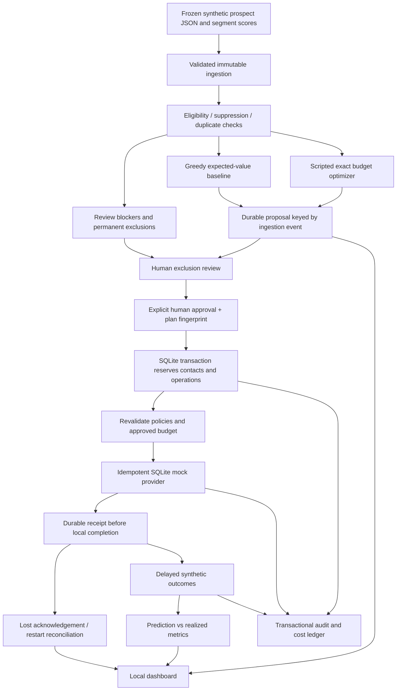

# AcquisitionOps architecture

## State machine

```mermaid
stateDiagram-v2
    [*] --> REVIEW_REQUIRED: missing / contradictory records or no feasible plan
    [*] --> PROPOSED: eligible plan without blockers
    REVIEW_REQUIRED --> PROPOSED: human acknowledges excluded records; nonempty plan
    PROPOSED --> APPROVED: explicit APPROVE + actor + deterministic checks
    APPROVED --> EXECUTING: mock execution
    EXECUTING --> EXECUTING: restart reconciles existing receipt
    EXECUTING --> FAILED: any uncompleted operation
    FAILED --> EXECUTING: explicit retry; three attempts maximum per operation
    EXECUTING --> COMPLETED: all operations acknowledged
    COMPLETED --> SETTLED: all delayed outcomes observed
```

`REVIEW_REQUIRED` with an empty plan cannot be waived. Exhausted attempts stay failed; approval is preserved. All contacts are reserved at approval, so a partially failed campaign does not leak its contacts to a later campaign. SQLite `BEGIN IMMEDIATE`, a unique event key, unique contact reservations and unique receipt keys serialize conflicting mutations. FULL synchronous mode and WAL provide local durability. The simulated clock persists and only moves forwards.

Approval fingerprints bind the budget and complete selected records. Policy checks run at approval and again before every new receipt. New contradictions, modified records, suppressed records, duplicated contacts, overspend and plan tampering block execution. Prospect notes are inert data and are never interpreted as instructions. Neither the optimizer nor the dashboard has a policy bypass flag.

## Reuse and isolation

The new module lives under the existing `agent_arena` package. It directly reuses `audit.utc_now`, hashing, `AuditStore`, artifact manifests, `models.AgentResult`, `Phase`, `RunState` and `jsonable`. Scripted recommendations use the existing agent result envelope with provider kind `scripted` and no model. The evaluation preserves the repository's separation between recommendations, deterministic checks and verifiable artifacts.

The existing repository evaluator is coupled to `RepositoryManager` and worktree verification. It is deliberately not invoked under the recovery restriction. AcquisitionOps supplies a small domain-specific evaluator and transactional state machine because coding-run states and file-oriented audit writes cannot atomically commit campaign reservations, costs and approvals. No existing orchestrator or provider route is modified.

The dashboard uses the standard-library HTTP server, HTML forms, strict loopback binding, host/origin validation, an unpredictable form token, escaped text and a restrictive content security policy. It has no external assets or scripts. Browser execution remains a separate host acceptance check; template and handler tests cannot establish visual or browser correctness.
